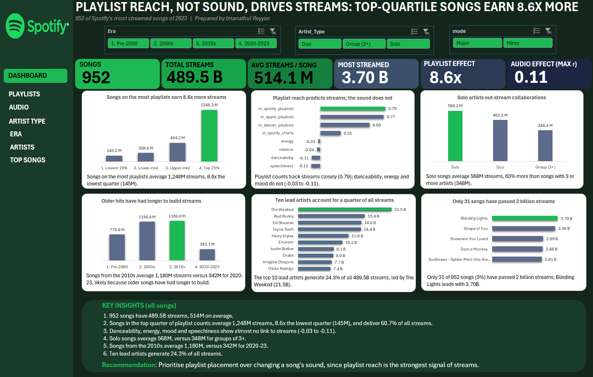

# 🎶 Spotify Most Streamed Songs 2023: Excel Analysis

What drives a song's streams? An end-to-end Excel analysis of 952 of Spotify's most streamed songs of 2023: data checks, helper columns, pivot tables, slicers and an interactive dashboard.

**Headline:** Songs on the most playlists average **1,248M streams, 8.6x** the lowest quarter (145M). Playlist counts track streams closely (**r = 0.79**), while danceability, energy, mood and speechiness show almost no link (**-0.03 to -0.11**).

## 🔑 Key findings

| # | Finding | Evidence |
|---|---|---|
| 1 | Playlist reach is the strongest signal of streams | Top-quarter songs average 1,248M streams versus 145M for the lowest quarter (8.6x) and deliver 60.7% of all streams |
| 2 | The sound of a song does not predict streams | Danceability, energy, mood (valence) and speechiness correlate -0.03 to -0.11 with streams |
| 3 | Solo artists out-stream collaborations | Solo songs average 568M, 63% more than groups of 3+ (348M) |
| 4 | Older hits have had longer to build streams | 2010s songs average 1,180M versus 342M for 2020-23 (a fair comparison needs equal time on the platform) |
| 5 | A few artists dominate | The top 10 lead artists generate 24.3% of all 489.5B streams, led by The Weeknd (21.5B) |
| 6 | Very few songs pass 2 billion | 31 of 952 songs (3%); Blinding Lights leads with 3.70B |

**💡 Recommendation:** prioritise playlist placement over changing a song's sound, since playlist reach is the strongest signal of streams.

**Caution:** correlation is not causation. Hits also attract playlists, so this data cannot prove that playlists cause streams.

## 📊 Dashboard

- **6 PivotCharts**, each with a statement heading and a note
- **3 slicers** (Era, Artist Type, Mode) connected to every pivot table
- **6 KPI tiles:** songs, total streams, average streams per song, most streamed, playlist effect, audio effect
- The pivot charts and the first KPI tiles use `GETPIVOTDATA` and respond to the slicers. The correlation chart and the Most Streamed and Audio Effect tiles always show all songs.

## 🧹 Data preparation

Every step is recorded in the `Cleaning_Log` sheet (12 checks).

- Removed 1 corrupt row (text in the streams cell): 953 rows to 952
- Checked duplicates (0), value ranges (valid) and repeated titles (4 pairs kept, different stream counts)
- Converted text-stored numbers, replaced 95 blank keys with "Unknown", kept 50 blank Shazam values on purpose
- Renamed 8 headers for clean formulas
- Added helper columns: `Streams_M`, `Lead_Artist`, `Artist_Type`, `Era`, `Playlist_Tier`
- Converted the data to a table (`tblSpotify`) so all pivots share one source

## 📈 Excel skills used

Tables and structured references, PivotTables and PivotCharts, Slicers with Report Connections, `GETPIVOTDATA`, `CORREL`, `MEDIAN`, `MAX`, `IFERROR`, `SUMPRODUCT`, `COUNTIF`, Go To Special, Text to Columns, custom number formats, shape-linked KPI tiles, hyperlink navigation, dashboard design.

## 📁 Files

| File | What it is |
|---|---|
| `Spotify_Analysis.xlsx` | Full workbook: Dashboard, Calc, Cleaning_Log, 6 pivot sheets, Data, Raw_Data |
| `spotify-2023.csv` | Original dataset |
| `Dashboard.png` | Dashboard screenshot |

## 📦 Dataset

[Most Streamed Spotify Songs 2023](https://www.kaggle.com/datasets/nelgiriyewithana/top-spotify-songs-2023) (Kaggle). It covers popular songs from 2023, not all songs on Spotify, so findings describe this group only.

## 👩‍💻 Author

**Imanathul Reyyan**, BSc Applied Data Analytics, University of Colombo
🌐[Portfolio](https://imanathulreyyan.github.io) | 🔗 [LinkedIn](https://www.linkedin.com/in/imanathul-reyyan) | ✉️ imanareyyan@gmail.com
